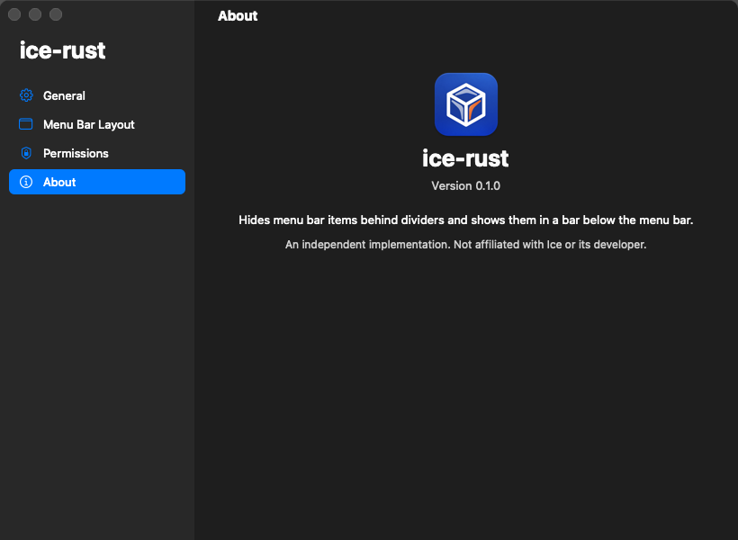
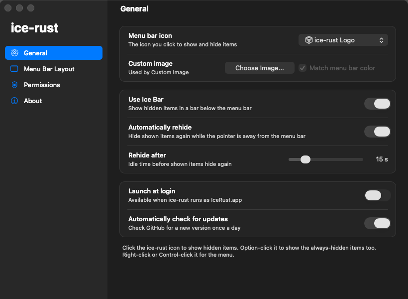

<p align="center">
  
</p>

<h1 align="center">ice-rust</h1>

ice-rust is a menu bar manager for macOS, written in Rust. It hides menu bar
items behind dividers and shows them on demand, in the menu bar itself or in
a panel below it.

## A Rust port of Ice

ice-rust is a Rust port of [Ice](https://github.com/jordanbaird/Ice), the
menu bar manager by Jordan Baird (Copyright (C) 2023-2025 Jordan Baird,
GPL-3.0). It is a derivative of Ice and is distributed under the same license.

What comes from Ice:

- The features and how they behave: the divider, the Always-Hidden section,
  the Ice Bar, auto-rehide and the drag-and-drop Menu Bar Layout.
- The UI design and its text, including the Menu Bar Layout page, its section
  names and its tip, and the name "Ice Bar".
- The macOS mechanisms, constants and settings keys (`UseIceBar`,
  `AutoRehide`, `RehideInterval`), worked out from Ice's source code and the
  installed Ice app, as recorded in
  [docs/ice-internals-evidence.md](docs/ice-internals-evidence.md).

What is new: the code. ice-rust is written in Rust against AppKit through the
objc2 crates, rebuilt from that analysis rather than translated line by line
from Ice's Swift. It is not affiliated with or endorsed by Ice or its
developer. Ice is the mature, full-featured app; ice-rust covers a subset of
it (see [Differences from Ice](#differences-from-ice)).

## Features

- **Hide and show with a divider.** A divider status item sits left of the
  ice-rust icon. Hiding stretches it until every item to its left leaves the
  screen; a click on the icon brings them back.
- **Always-Hidden section.** A second divider at the far left of the menu bar
  holds items you rarely need. It starts empty; drag items into it from Menu
  Bar Layout or with a Command-drag. Option-click the icon to show them (this
  shows every section).
- **Ice Bar panel with click-through.** With Use Ice Bar on (the default), a
  click on the icon opens a panel below the menu bar with an image of each
  hidden item. Clicking an image reveals that item's section and clicks the
  real item.
- **Settings window.** General settings, a Menu Bar Layout page where you
  drag items between the Visible, Hidden and Always-Hidden bars to move the
  real items, a Permissions page and an About page.
- **Auto-rehide.** A revealed section hides again after an idle interval
  (15 s by default, 5 to 60 s in Settings) while the pointer is outside the
  menu bar and no menu or panel is open.
- **Launch at login.** A switch on the General page registers IceRust.app as
  a login item through macOS's `SMAppService`.
- **Automatic updates.** ice-rust checks GitHub Releases once a day, asks
  before installing, verifies the update's Ed25519 signature, replaces
  itself and relaunches. See [Automatic updates](#automatic-updates).

## Features/Roadmap

The list below follows the Features/Roadmap section of
[Ice's README](https://github.com/jordanbaird/Ice#featuresroadmap) item by
item. The Ice column copies Ice's own status: "Yes" for a shipped feature,
"Roadmap" for an item Ice lists as planned. The ice-rust column is the status
of this repository.

### Menu bar item management

| Feature | Ice | ice-rust | Notes |
|---|---|---|---|
| Hide menu bar items | Yes | Yes | |
| "Always-hidden" menu bar section | Yes | Yes | Option-click the icon to show it. |
| Show hidden items when hovering over the menu bar | Yes | No | |
| Show hidden items when an empty area in the menu bar is clicked | Yes | No | |
| Show hidden items by scrolling or swiping in the menu bar | Yes | No | |
| Automatically rehide menu bar items | Yes | Partial | Timed only (5 to 60 s), held while a menu or panel is open. Ice also has smart and focused-app strategies. |
| Hide application menus when they overlap with shown items | Yes | No | |
| Drag and drop interface to arrange individual items | Yes | Yes | Moves on-screen items only: the sections involved are revealed first. |
| Display hidden items in a separate bar (Ice Bar) | Yes | Yes | Clicking an image reveals the whole section, then clicks the real item. |
| Search menu bar items | Yes | No | |
| Menu bar item spacing | Yes (beta) | No | |
| Profiles for menu bar layout | Roadmap | No | |
| Individual spacer items | Roadmap | No | |
| Menu bar item groups | Roadmap | No | |
| Show items when trigger conditions are met | Roadmap | No | |

### Menu bar appearance

| Feature | Ice | ice-rust |
|---|---|---|
| Menu bar tint (solid and gradient) | Yes | No |
| Menu bar shadow | Yes | No |
| Menu bar border | Yes | No |
| Custom menu bar shapes (rounded and/or split) | Yes | No |
| Remove background behind menu bar | Roadmap | No |
| Rounded screen corners | Roadmap | No |
| Different settings for light/dark mode | Roadmap | No |

### Hotkeys

ice-rust has no global hotkeys yet. Its actions are available from the icon
and its menu.

| Feature | Ice | ice-rust | Notes |
|---|---|---|---|
| Toggle individual menu bar sections | Yes | No | Click or Option-click the icon. |
| Show the search panel | Yes | No | No search panel. |
| Enable/disable the Ice Bar | Yes | No | "Use Ice Bar" in the icon menu and on the General page. |
| Show/hide section divider icons | Yes | No | |
| Toggle application menus | Yes | No | |
| Enable/disable auto rehide | Roadmap | No | "Automatically rehide" on the General page. |
| Temporarily show individual items | Roadmap | No | |

### Other

| Feature | Ice | ice-rust |
|---|---|---|
| Launch at login | Yes | Yes |
| Automatic updates | Yes | Yes |
| Menu bar widgets | Roadmap | No |

### Only in ice-rust

- `ice-rust probe`: a read-only command that lists the menu bar windows,
  walks the three sections from the dividers, and writes each hidden item's
  image as a PNG. It can read Ice's own dividers too.
- `ice-rust render-settings`: draws any Settings page into a PNG without
  showing a window.
- Window captures run on a worker thread with a 1 s limit, so a stuck
  window-server capture shows placeholder tiles instead of freezing the app.
  Ice issue [#777](https://github.com/jordanbaird/Ice/issues/777) reports
  that freeze in Ice on macOS 26.1.
- [docs/ice-internals-evidence.md](docs/ice-internals-evidence.md) documents
  how Ice works, with source, binary and runtime evidence.

### Roadmap for ice-rust

Planned, in rough priority order. Nothing here is implemented yet.

- [ ] Release Settings memory when the window closes (L7 in
  [docs/design.md](docs/design.md))
- [ ] Global hotkeys for the sections and the Ice Bar
- [ ] Show hidden items on hover, on a click in empty menu bar space, and on scroll
- [ ] Smart and focused-app rehide strategies
- [ ] Horizontal scrolling in the Ice Bar instead of the "+N" tile
- [ ] Search menu bar items

## Screenshots

<p align="center">
  
  
</p>

`ice-rust render-settings` drew both pages offscreen. With
`--default-settings`, the General page shows the defaults: Use Ice Bar on,
Automatically rehide on, rehide after 15 s. The offscreen render draws the
track of a switch that is on in gray; the knob at the right marks it on.

## Requirements

- macOS 14 or later (the app bundle's minimum). ice-rust has been tested
  only on macOS 26.3 on Apple Silicon. Intel Macs and macOS 14 and 15 are
  untested.
- Rust 1.88 or later. The crate uses edition 2024 and let chains, which
  stabilized in 1.88, and declares `rust-version = "1.88"`; clippy's
  `incompatible_msrv` check passes against it. It is built and tested with
  Rust 1.91.1; no build has run on 1.88 itself.
- Screen Recording permission, to read status item window titles (on
  macOS 26 this is how ice-rust finds its own dividers) and to capture item
  images.
- Accessibility permission, to post the synthesized clicks and drags that
  click an item from the Ice Bar and move items from the Menu Bar Layout
  page.

With Use Ice Bar off, plain hide and show work without either permission.
With Use Ice Bar on (the default), a click on the icon without Screen
Recording opens the Ice Bar with a "Screen Recording permission needed"
tile and reveals no items; turn Use Ice Bar off in the icon's menu or on the
General page to show hidden items in the menu bar instead. ice-rust asks for
missing permissions at launch.

## Build and run

Quit Ice, or any other menu bar manager, first. Two managers that both hide
items with expanded dividers conflict in the same menu bar.

### Download

1. Download `IceRust-<version>-arm64.zip` from
   [Releases](https://github.com/UnkAtreus/ice-rust/releases) (Apple Silicon
   only) and unzip it.
2. Move `IceRust.app` to `/Applications`.
3. Open it. The app has an ad-hoc signature and is not notarized, so macOS
   blocks the first launch. Open System Settings > Privacy & Security and
   click Open Anyway, or run
   `xattr -dr com.apple.quarantine /Applications/IceRust.app` and open it
   again.
4. Grant Screen Recording and Accessibility when asked (see
   [Requirements](#requirements)).

### Build from source

```sh
git clone https://github.com/UnkAtreus/ice-rust
cd ice-rust
cargo run --release
```

Permissions attach to the process that macOS holds responsible, so a binary
started from a terminal uses the terminal's grants. For standalone use,
build the app bundle and open it:

```sh
scripts/bundle.sh          # builds target/IceRust.app; does not launch it
open target/IceRust.app
```

The bundle has no Dock icon (`LSUIElement`), the bundle identifier
`local.icerust.IceRust` (set `BUNDLE_ID` to change it) and an ad-hoc
signature. An ad-hoc signature is tied to the binary's code hash, so expect
to grant the permissions again after a rebuild.

Quitting ice-rust removes its three status items, and the items it hid
return.

## Usage

| Action | Result |
|---|---|
| Click the icon | Shows or hides the hidden section. With Use Ice Bar on, opens or closes the Ice Bar with the hidden items. |
| Option-click the icon | Shows or hides the always-hidden section; showing it shows everything. With Use Ice Bar on, opens the Ice Bar with the always-hidden items. |
| Right-click or Control-click the icon | Opens the menu: Show/Hide Hidden Items, Show/Hide Always-Hidden Items, Use Ice Bar, Settings..., Arrange Menu Bar Items..., Check for Updates..., Quit ice-rust. |
| Click an image in the Ice Bar | Closes the bar, reveals the item's section, waits up to 1 s for the item to reach the screen, and clicks it. |
| Settings... (Command-comma while the menu is open) | Opens the Settings window: General, Menu Bar Layout, Permissions, About. |
| Check for Updates... | Checks GitHub now, even with automatic checks off, and offers a newer version or says ice-rust is up to date. Also on the About page. |
| Arrange Menu Bar Items... | Opens Settings on the Menu Bar Layout page. Drag a tile to a new place in any bar; ice-rust moves the real item and rebuilds the bars from the menu bar. |
| Command-drag in the menu bar | Rearranges items with macOS's own drag. Keep the ice-rust icon right of both dividers; ice-rust refuses to hide while a divider sits right of the icon. |

## Automatic updates

Available from version 0.1.1. Version 0.1.0 has no updater: install 0.1.1
by hand once, and later versions arrive through the app.

- **When.** With "Automatically check for updates" on (the default), the
  first check runs a minute after launch and then once a day. "Check for
  Updates..." checks at any time. The check is one request to the GitHub
  Releases API; nothing else is sent.
- **What you see.** A newer version shows its release notes with Install,
  Later and Skip This Version. Skipped versions are not offered again by
  automatic checks; a manual check offers them.
- **How it is verified.** Each release carries `IceRust-<version>-arm64.zip`
  and a `.sig` file holding an Ed25519 signature over the zip. The public
  key is built into the app; the private key never leaves the release
  machine. ice-rust verifies the signature before it unpacks anything, then
  checks that the zip holds only `IceRust.app` with the expected bundle
  identifier and a higher version, and that its code signature is valid. A
  failed check leaves the installed app untouched. Equal or older versions
  are never installed.
- **Installing.** The old bundle moves to `IceRust.app.previous`, the new
  one takes its place, and ice-rust relaunches; the next launch deletes the
  previous bundle. If the move fails, the old bundle goes back.
- **Permissions after an update.** The app has an ad-hoc signature, so macOS
  treats each version as a new app. After updating, turn IceRust off and on
  again in Privacy & Security > Screen Recording and > Accessibility, or
  remove it and add it again. ice-rust shows this once after an update when a
  permission is missing.
- **Limits.** Updating needs write access to the folder that holds
  IceRust.app. A standard (non-admin) account cannot write `/Applications`,
  so ice-rust reports that and links the release page instead; there is no
  administrator prompt. An app opened from Downloads runs from a read-only
  App Translocation copy; move it to Applications first.

## How it works

- **Hiding.** Each divider is an `NSStatusItem`. Hiding sets its length to
  10000 pt. AppKit lays status items out from the right, so every item left
  of the divider moves off every display. Showing sets the length back to
  variable. On macOS 26.3 the system clamps the divider to 5016 pt, which
  still clears displays up to about 5000 pt wide.
- **Finding items.** ice-rust lists windows with the public
  `CGWindowListCopyWindowInfo`, keeps status item windows (layer 25), and
  walks the chain of windows whose edges touch, starting at its divider. The
  walk stops at a gap, at the always-hidden divider, or at any window 1000 pt
  or wider.
- **Item images.** `CGWindowListCreateImageFromArray` captures windows by id,
  including items parked off screen. ice-rust captures one composite, crops
  each item from it, and captures an item alone when its crop is fully
  transparent. Every capture runs on a worker thread with a 1 s timeout.
- **Clicks and moves.** Click-through posts a mouse-down and two mouse-ups at
  the item's center. The Menu Bar Layout page moves an item with a
  synthesized Command-drag: a mouse move to the item, a Command mouse-down,
  8 Command drag events, a mouse-up without flags at the drop point, then a
  Command key-up so no modifier stays down (finding L4). Each mouse event
  carries a tag, and a listen-only event tap restores the cursor once the
  last tagged event has gone through.

[docs/technical.md](docs/technical.md) has the details: the chain walk, the
capture path, the move engine, the probe output format, the stored settings
and the macOS 26 behavior. [docs/design.md](docs/design.md) is the design
contract with the findings of every test run, and
[docs/ice-internals-evidence.md](docs/ice-internals-evidence.md) is the
evidence ledger of Ice's mechanisms, with source lines, binary disassembly
and runtime observations.

## Differences from Ice

- ice-rust has no global hotkeys, show on hover, show on click in empty menu
  bar space, show on scroll, search, menu bar appearance settings, hiding of
  application menus, or Ice's smart and focused-app rehide strategies. Its
  Settings window has no Hotkeys, Appearance or Updates pages.
- Discovery uses only the public window list and window geometry. Ice uses
  private CoreGraphics calls for the menu bar window list, spaces and the
  active menu bar display, and an XPC helper with Accessibility to find the
  app behind each item.
- Click-through reveals the item's whole section for a moment, then clicks
  the item. Ice moves the single item into the visible section, clicks it,
  and moves it back later.
- Moves work on on-screen items: ice-rust shows the sections a move touches
  first. Ice moves off-screen items through a private event relay.
- Shown dividers draw a chevron (single for hidden, double for
  always-hidden). Ice's default collapses them to zero width through an
  AppKit layout constraint.
- Use Ice Bar defaults to on. Ice defaults it to off.
- An always-hidden divider that ends up right of the hidden divider is
  reported on stderr and left in place. Ice moves it back.

## Performance

ice-rust uses less memory than Ice. Measured on one Mac (macOS 26.3, Apple
Silicon, four displays) in October 2026 with `footprint`, which reports the
same physical footprint as the Memory column in Activity Monitor:

| App | When | Footprint |
|---|---|---|
| Ice 0.11.13-dev.2 | 12 s after launch, Ice Bar off | 86 MB, plus 7.5 MB for its MenuBarItemService helper |
| Ice 0.11.13-dev.2 | 1 min 42 s after launch | 78 MB, plus 7.4 MB for the helper |
| ice-rust (current) | 2.5 h of everyday use as a menu bar app | 62 MB, one process |
| ice-rust (current) | Settings open, after two moves | 70 MB |
| ice-rust (first version, no Settings window) | 10 min, about five Ice Bar opens | 32 MB |

Where the difference comes from:

- **No image cache that grows.** ice-rust captures item images when the Ice
  Bar or the Menu Bar Layout page opens. The Ice Bar drops its images when
  it closes; the Layout page keeps only its latest snapshot (L7). Ice keeps
  its images in a cache that never evicts entries. Ice users report
  about 4 GB after long runtimes
  ([#530](https://github.com/jordanbaird/Ice/issues/530)), and an open pull
  request measured a 983 MB image cache after 15 days
  ([#804](https://github.com/jordanbaird/Ice/pull/804)).
- **One process.** On macOS 26 Ice runs a separate XPC helper to find which
  app owns each item. ice-rust has no helper process.
- **Fewer frameworks and windows.** No SwiftUI, Combine or Sparkle updater.
  Ice keeps four settings windows alive offscreen from launch; ice-rust
  creates its Settings window only when you open it.
- **Captures cannot freeze the app.** Window captures run on a worker
  thread with a 1 s limit (see Ice issue
  [#777](https://github.com/jordanbaird/Ice/issues/777) for the freeze this
  avoids).

What these numbers do not cover:

- Each row is a single run on one machine. ice-rust has no multi-day soak
  test yet, so long-run growth is untested; the Ice long-run figures come
  from Ice's issue tracker, not from this machine.
- Closing Settings does not release its memory yet (L7, below), so
  ice-rust stays near 70 MB after Settings has been open until you quit it.
- The comparison covers memory only. CPU and energy use were not measured.

## Known limitations and open issues

- **Tested on one machine.** All live tests ran on macOS 26.3, Apple Silicon,
  with four displays and Ice quit.
- **Deprecated capture API.** `CGWindowListCreateImageFromArray` is
  deprecated, and its Swift initializer is obsoleted in the macOS 15 SDK. The
  C function still works on macOS 26.3. A comment in Ice's source says
  ScreenCaptureKit cannot produce composite images of off-screen menu bar
  items, so there is no drop-in replacement, and a future macOS release can
  break item images. On macOS 26 the call goes through a ScreenCaptureKit
  proxy and can block forever when a second process runs the same
  executable, for example `ice-rust probe` while the app runs (finding G5).
  ice-rust then shows placeholder tiles after the 1 s timeout. Running the
  probe from a copy of the binary at another path avoids the hang.
- **Displays asleep.** With every display asleep, each capture of an
  on-screen window takes about 1 s and returns a transparent image
  (finding G6), so the Visible bar in Menu Bar Layout shows placeholders.
  ice-rust does not yet skip those captures while the displays sleep.
- **Settings memory not released (L7).** Closing the Settings window does
  not release its memory: about 16 MB of images and 24 MB of small
  allocations stay, for a footprint of 69 MB after closing. The first
  version of ice-rust, which had no Settings window, measured 32 MB
  (finding L6 in [docs/design.md](docs/design.md)). The planned fix drops
  the layout snapshot, tile images and window content on close.
- **Escape and status menus (L5).** A synthetic Escape did not close the
  status item menu opened in testing; a click elsewhere did. A real keyboard
  Escape is untested.
- **Move tuning.** Live moves landed in the right place, but the move timings
  and drop offsets are starting values that have not been tuned.
- **Ice Bar overflow.** When the hidden items are wider than the display,
  the Ice Bar shows the items nearest the divider and a "+N" tile for the
  rest. Those items are reachable only with Use Ice Bar off. The Menu Bar
  Layout bars scroll instead.
- **Room in the menu bar.** If a revealed section does not fit next to the
  app menus or the notch, macOS draws only what fits, and click-through gives
  up on an item that does not reach the screen within 1 s.
- **Main-thread waits.** The Menu Bar Layout page waits on the main thread
  for its captures, up to 1 s per capture, when it opens and on each 3 s
  refresh.
- **Icon placement.** Dropping the ice-rust icon onto an expanded, invisible
  divider while the sections are hidden is not detected while ice-rust runs;
  a relaunch resets the order if AppKit saved it.
- **Window size.** The Settings window opens at 820 x 600 pt each time; it
  does not remember a larger size.
- **Permissions after a rebuild.** The bundle's ad-hoc signature is tied to
  the binary's code hash, so a rebuilt bundle needs its permissions granted
  again.

[docs/technical.md](docs/technical.md#limitations-and-differences-from-ice)
lists every limitation, and [docs/design.md](docs/design.md) records each
finding with its evidence.

## Development

```sh
cargo fmt --check
cargo clippy --all-targets -- -D warnings
cargo test        # 241 tests: 222 in the library, 19 in the binary
```

The logic lives in pure modules with unit tests (`chain`, `arrange`,
`sections`, `rehide`, `geometry` and others under `src/`). The macOS code is
under `src/platform/` and compiles only on macOS.

Two subcommands check behavior without touching the menu bar:

```sh
# Read-only: lists windows, walks the three sections, captures hidden items.
cargo run --release -- probe [--divider Ice.ControlItem.Hidden] [--out <dir>] [--json]

# Draws a Settings page into a PNG without showing a window.
cargo run --release -- render-settings --page <general|layout|permissions|about> --out page.png
```

`probe` posts no events, creates no status items and writes no defaults.
`render-settings` orders no window on screen and moves nothing.

Update commands:

```sh
cargo run --release -- check-update [--json]     # one read-only check against GitHub
cargo run --release -- update-verify <zip>       # checks <zip>.sig with the built-in key
cargo run --release -- apply-update --app <IceRust.app> --zip <zip> --sig <sig>
```

### Releasing

1. Set the new version in `Cargo.toml` and commit.
2. Run `scripts/release.sh <version>`. It builds `dist/IceRust.app`, zips it,
   signs the zip with the private key at `~/.config/ice-rust/update-signing.key`
   (`ICE_RUST_UPDATE_KEY` overrides the path), verifies the signature with the
   key built into the new binary, writes the SHA-256 file, and prints the
   `git tag` and `gh release create` commands to publish. It publishes nothing
   itself.
3. Keep a backup of the private key. Without it, installed copies cannot
   accept new updates; a new key needs a manual update by every user.

`ice-rust update-keygen --out <path>` makes a new key pair (the private key
file is mode 600 and never overwritten) and prints the public key to put in
`UPDATE_PUBLIC_KEY` in `src/update.rs`.

`scripts/make-icons.py` rebuilds the app icon, the bundle icon and the menu
bar glyphs under `assets/` from `assets/logo-source.png` (needs Pillow and
Xcode's `iconutil`):

```sh
python3 scripts/make-icons.py assets/logo-source.png assets
```

## License

ice-rust is a derivative of Ice, Copyright (C) 2023-2025 Jordan Baird, and is
licensed under the GNU General Public License v3.0 only (GPL-3.0-only), the
license Ice uses. See [LICENSE](LICENSE) and [NOTICE](NOTICE).

## Acknowledgements

- [Ice](https://github.com/jordanbaird/Ice) by Jordan Baird, licensed under
  GPL-3.0. ice-rust is a port of it, and the evidence ledger documents how it
  works.
- The [objc2](https://github.com/madsmtm/objc2) crates (`objc2`,
  `objc2-foundation`, `objc2-app-kit`, `objc2-core-foundation`,
  `objc2-core-graphics`, `block2`), which provide the Rust bindings to AppKit,
  Foundation and CoreGraphics.
